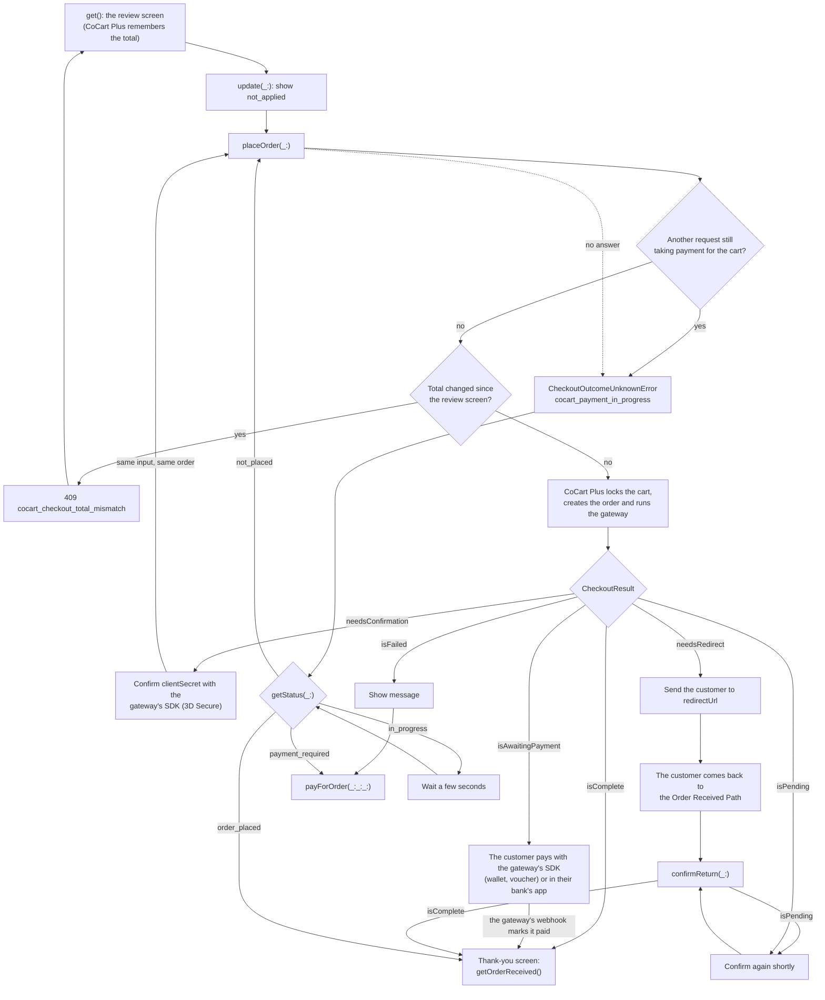

# Checkout

> Requires **CoCart Plus 2.0** and at least one WooCommerce payment gateway.

Checkout turns the customer's cart into an order and takes payment. **The card never passes through the CoCart SDK**:
- The gateway's own iOS SDK (for Stripe, stripe-ios with your publishable key) collects the card and sends it straight to the gateway.
- Your app gets back a payment method ID, and places the order with it.

- [How It Works](#how-it-works)
- [Quick Start](#quick-start)
- [Showing the Checkout](#showing-the-checkout)
- [Placing the Order](#placing-the-order)
- [Reading the Result](#reading-the-result)
- [3D Secure in the App](#3d-secure-in-the-app)
- [Wallets, Vouchers and Bank Transfers](#wallets-vouchers-and-bank-transfers)
- [Off-Site Steps](#off-site-steps)
- [Saved Payment Methods](#saved-payment-methods)
- [The Thank-You Screen](#the-thank-you-screen)
- [Paying for an Unpaid Order](#paying-for-an-unpaid-order)
- [Address Autocomplete](#address-autocomplete)
- [Errors Before Payment](#errors-before-payment)
- [When the Outcome Isn't Known](#when-the-outcome-isnt-known)
- [Changing a Subscription's Payment Method](#changing-a-subscriptions-payment-method)

## How It Works

1. **Show the review screen** with `get()`: the items, totals, addresses and shipping rates. CoCart Plus remembers the total it showed, so call it for the screen the customer reviews, not just before placing the order. Build the form from `getConfig()`, and list the payment methods from `getPaymentMethods()`.
2. **Save what the customer enters** with `update(_:)`, and show what wasn't applied (`result.not_applied`).
3. **The gateway's SDK turns the card into a payment method ID.**
4. **`placeOrder(_:)`** creates the order and takes payment.
5. **Act on the result:**

   | Result | What to do |
   |---|---|
   | `isComplete` | Show the thank-you screen (`getOrderReceived(_:_:)`) |
   | `isAwaitingPayment` | The order is placed; the customer pays with the gateway's SDK (a wallet or a voucher), or in their banking app |
   | `needsConfirmation` | Confirm the card with the gateway's SDK (3D Secure), then call `placeOrder(_:)` again with the same input |
   | `needsRedirect` | Send the customer to `redirectUrl`, then call `confirmReturn(_:)` with the URL they come back to |
   | `isPending` | The gateway hasn't confirmed yet: confirm again shortly |
   | `isFailed` | Show `message`; take another payment with `payForOrder(_:_:_:)` |

6. **When the outcome isn't known** (no answer came back, or another request is still taking payment: `CheckoutOutcomeUnknownError`), ask `getStatus(_:)`: `payment_required` → `payForOrder(_:_:_:)`; `in_progress` → ask again; `not_placed` → place the order again.
7. **`409 cocart_checkout_total_mismatch`**: the total changed since the review screen. Get the checkout again and show the new total.

The whole flow, including the lock CoCart Plus takes so that a double tap, or a request sent again, can't take payment twice:



The client never sends `placeOrder(_:)` again by itself, since it may already have run on the store. The CoCart Plus calls (checkout and account) are never retried by the client, not even a `GET`.

All checkout calls are `async throws` and use the same client, and so the same cart, as `client.cart()`.

## Quick Start

Collect the card with Stripe's `STPPaymentCardTextField` and create a payment method:

```swift
STPAPIClient.shared.publishableKey = "pk_test_…"

let paymentMethod = try await STPAPIClient.shared.createPaymentMethod(with: cardField.paymentMethodParams)
```

Place the order:

```swift
let result = try await client.checkout().placeOrder([
    "billing_address": [
        "first_name": "Jane",
        "last_name": "Doe",
        "address_1": "1 Main Street",
        "city": "Paris",
        "postcode": "75001",
        "country": "FR",
        "email": "jane@example.com",
    ],
    "shipping_method": "flat_rate:1",
    "payment_method": "stripe",
    "payment_data": ["wc-stripe-payment-method": paymentMethod.stripeId],
])

if result.isComplete {
    showThankYou(orderId: result.orderId!, orderKey: result.orderKey!)
}
```

## Showing the Checkout

Call `get()` for the screen the customer reviews before paying. CoCart Plus remembers the total it showed, and refuses the order if the total has changed by then (`409 cocart_checkout_total_mismatch`), so the customer never pays an amount they didn't see. Don't call it just before placing the order: that would remember a total the customer never saw.

```swift
let checkout = try await client.checkout().get()

checkout.getBool("payment.needs_payment")   // false when the order is free
checkout.getBool("delivery.needs_shipping")
checkout.get("delivery.packages")           // each package, with its rates and chosen_rate
checkout.get("items")
checkout.get("totals")                      // subtotal, discount_total, shipping_total, fee_total, total_tax, total
checkout.get("total_lines")                 // display lines: key, label, amount
checkout.get("customer.billing")
```

`get(currency:formatted:thumb:)` takes optional parameters: `currency` shows prices in another currency (multi-currency stores), `formatted: true` gives amounts formatted for display (`"$18.00"`) instead of minor units (`"1800"`), and `thumb: false` leaves each item's `featured_image` empty.

Save what the customer has entered so far, without placing the order. The totals, taxes and shipping rates update to match:

```swift
let updated = try await client.checkout().update([
    "billing_address": ["country": "FR", "postcode": "75001"],
    "shipping_method": "flat_rate:1",
])

updated.getString("result.code")    // "checkout_updated", or "checkout_partly_updated"
updated.get("result.not_applied")   // [["field": "shipping_method", "code": "cocart_invalid_shipping_method", "message": "…"]]
```

With `checkout_partly_updated`, show each entry of `result.not_applied` next to its field. `update(_:)` also applies or removes a coupon: `["coupon_code": "SUMMER", "coupon_action": "apply"]` (or `"remove"`).

The store's form settings: fields, required fields per country, countries, and whether guests can check out. Build your form from these. No cart needed:

```swift
let config = try await client.checkout().getConfig()
config.get("fields.billing")
config.get("countries")
config.getString("order_received_url")               // where off-site steps come back to
config.getBool("address_autocomplete.enabled")       // see Address Autocomplete
config.get("address_autocomplete.providers")         // [["id": "google_places", "name": "Google Places"]]
config.getString("store.terms_text")                 // "I have read and agree to the website terms and conditions"
config.get("store.terms_links")                      // [["text": "terms and conditions", "url": "…"]]
config.getString("store.terms_url")
config.getString("store.privacy_url")
```

The payment methods for this cart, as a list:

```swift
let methods = try await client.checkout().getPaymentMethods().toArray()
for case let method as [String: Any] in methods { /* method["id"], method["title"], method["supports"] */ }
```

Shipping methods work as in the [cart](cart.md).

## Placing the Order

| Field | Notes |
|---|---|
| `billing_address` | `first_name`, `last_name`, `address_1`, `city`, `postcode`, `country` and `email` at least, plus what `getConfig()` marks required |
| `shipping_address` | Same fields, when shipping goes elsewhere |
| `shipping_method` | A rate ID from `delivery.packages[].rates[].id` |
| `payment_method` | A gateway ID: `stripe`, `woocommerce_payments`, `paypal`, `bacs`, `cod`…; leave it out for a free order |
| `payment_data` | What the gateway needs, as a dictionary (below) |
| `customer_note` | Optional |
| `create_account`, `customer_password` | Create an account for a guest, when the store allows it |
| `checkout_id` | Optional: your own ID for this checkout (16 to 64 letters, digits, `-` or `_`). Left out, the client sends a random one. See [When the Outcome Isn't Known](#when-the-outcome-isnt-known) |

`payment_data` carries **gateway tokens only**: the IDs the gateway's SDK gives you, never card numbers or other card details. It holds the keys the WooCommerce gateway reads:

| To… | Key | Value |
|---|---|---|
| Charge a new Stripe card | `wc-stripe-payment-method` | The payment method ID (`pm_…`) |
| Charge a new WooPayments card | `wcpay-payment-method` | The payment method ID |
| Charge a saved payment method | `wc-{gateway}-payment-token` | The saved method's `id` |
| Save the new card for later | `wc-{gateway}-new-payment-method` | `true` |

Offline gateways (`bacs`, `cheque`, `cod`) need no `payment_data`. A free order (`payment.needs_payment` is `false`) needs neither `payment_method` nor `payment_data`. Calling `placeOrder(_:)` again for the same cart updates the same order rather than creating a second one.

## Reading the Result

`placeOrder(_:)`, `payForOrder(_:_:_:)`, `confirmReturn(_:)` and `account().updateSubscriptionPaymentMethod(_:_:)` return a `CheckoutResult`, read from the `result` the store sends with the order (or the subscription). A declined card is a result, not a thrown error.

```swift
if result.isComplete {
    showThankYou(orderId: result.orderId!, orderKey: result.orderKey!)
} else if result.isAwaitingPayment {
    try await payOutsideTheCheckout(result)   // a wallet, a voucher, BLIK, a bank transfer
} else if result.needsConfirmation {
    try await confirmCard(result)             // 3D Secure in the app
} else if result.needsRedirect {
    try await openOffSite(result.redirectUrl!)
} else if result.isPending {
    showProcessing()                          // confirm again shortly
} else {
    showError(result.message)                 // "Your card was declined. Please try a different card."
}
```

`CheckoutResult`:

| Property | Meaning |
|---|---|
| `code` | `result.code` as sent, a `PaymentResultCode`: `.orderPlaced`, `.actionRequired`, `.paymentPending`, `.paymentFailed` or, for a subscription, `.paymentMethodChanged`. Open-ended: a value a gateway adds comes through as it is (`code.rawValue`). A response without one reads as `.paymentFailed` |
| `isComplete` | `order_placed` (paid, nothing to pay, or held for review or offline payment) or `payment_method_changed`, with no action left for the customer |
| `isAwaitingPayment` | `order_placed` **with** an action: the order is placed, but the customer still pays (Stripe wallets and vouchers, BLIK, Mercado Pago Pix and tickets, a Mollie bank transfer…). See [Wallets, Vouchers and Bank Transfers](#wallets-vouchers-and-bank-transfers) |
| `needsConfirmation` | `action_required` with a `clientSecret`: confirm it in the app, then make the same call again |
| `needsRedirect` | `action_required` with no `clientSecret` and an off-site address: send the customer to `redirectUrl`, then call `confirmReturn(_:)` |
| `isPending` | `payment_pending`: the gateway hasn't confirmed yet; confirm again shortly |
| `isFailed` | `payment_failed`: show `message`; the order can be paid again |
| `object` | `order`, or `subscription` after a subscription's payment method change |
| `orderId`, `orderKey`, `orderNumber`, `orderStatus` | The order's `id`, `key`, `number` and `status.code` (e.g. `processing`, `on-hold`, `pending`), when `object` is `order` |
| `subscriptionId` | The subscription's `id`, when `object` is `subscription` |
| `redirectUrl` | With `action_required`, the off-site step; otherwise the page to show once the payment is done (the order-received page, or the gateway's own). Only ever an `https` or `http` address: anything else in the response (a `javascript:` URL, another app's link) is left out |
| `clientSecret`, `intentType` | For [3D Secure in the app](#3d-secure-in-the-app), or a payment the customer makes in the app |
| `paymentMethodType` | The Stripe payment method to pay with when `isAwaitingPayment`: `cashapp`, `wechat_pay`, `boleto`, `oxxo` or `multibanco` |
| `actionType`, `actionData` | What the customer must do, as the gateway integration names it (`stripe_confirm_payment`, `stripe_voucher_payment`, `stripe_blik_confirmation_pending`…), and what it needs |
| `message` | A message for the customer, for every code: why a payment failed, or that the order was received |
| `errorCode` | CoCart's code to branch on when `isFailed` (below) |
| `gatewayErrorCode`, `gatewayMessage` | The gateway's own code and message, for your logs |
| `response` | The raw `CoCartResponse`: the order, or the subscription |

`message` and `gatewayMessage` are **plain text**: show them as text, never as HTML or Markdown.

Printing a result (`print`, `debugPrint`, `dump` or string interpolation) never shows `clientSecret` or `orderKey` (they print as `***`), leaves out `actionData` and `response`, and shows `redirectUrl` with its query values hidden, so a log line can't leak the payment's secret or the order key.

| `errorCode` | Meaning |
|---|---|
| `card_declined` | Declined, including for fraud |
| `insufficient_funds` | Not enough funds |
| `expired_card` | The card has expired |
| `incorrect_cvc`, `incorrect_number`, `incorrect_postcode` | Wrong details |
| `authentication_failed` | 3D Secure failed or was cancelled |
| `processing_error` | The gateway had a problem; try again |
| `payment_method_not_supported`, `amount_not_supported` | The gateway can't take this payment |
| `payment_failed` | The gateway didn't say why |

## 3D Secure in the App

Confirm `clientSecret` with Stripe's `STPPaymentHandler`, then call `placeOrder(_:)` again with the same input. It completes the same order.

```swift
let handler = STPPaymentHandler.shared()
let clientSecret = result.clientSecret!

handler.handleNextAction(forPayment: clientSecret, with: self, returnURL: "yourapp://stripe-redirect") { status, _, _ in
    guard status == .succeeded else { return } // .canceled or .failed: show an error
    Task {
        let retried = try await client.checkout().placeOrder(order) // same input as before
        // read `retried` as above
    }
}
// For result.intentType == "setup_intent", use handleNextAction(forSetupIntent:with:returnURL:completion:).
```

## Wallets, Vouchers and Bank Transfers

With some payment methods the order is placed before the customer pays, so `isAwaitingPayment` is `true` rather than `isComplete`. The cart has already been emptied.

- **With `clientSecret`** (Stripe's Cash App Pay, WeChat Pay, and Boleto, OXXO or Multibanco vouchers): hand it to Stripe's `STPPaymentHandler` the same way as [3D Secure in the App](#3d-secure-in-the-app). It opens Cash App, shows WeChat Pay, or shows the voucher. `paymentMethodType` says which it is.
- **Without one**, `actionType` and `actionData` say what to show: `stripe_blik_confirmation_pending` (approve in the banking app), a Mercado Pago Pix code or ticket, a Mollie bank transfer's details…

The gateway's webhook marks the order paid, so don't call `placeOrder(_:)` again. `checkout().getStatus(_:)` says `payment_required` until the payment goes through, then `order_placed`. A voucher is paid later, at a bank or a shop. If the customer gives up, the order stays unpaid, and `payForOrder(_:_:_:)` takes another payment for it.

## Off-Site Steps

Some payments finish on another site: PayPal approval, or a Stripe-hosted 3D Secure page. The customer comes back to the thank-you page: the **Order Received Path** set in CoCart Plus under Settings → Checkout (`/checkout/order-received/{order_id}/` by default), on your **Front-end site URL**. Your app must match that path, so if the setting changes, the app has to change too.

On iOS 17.4 and later, an `ASWebAuthenticationSession` can wait for that HTTPS address and hand it straight back:

```swift
let session = ASWebAuthenticationSession(
    url: URL(string: result.redirectUrl!)!,
    // Your Front-end site URL, and the Order Received Path set in CoCart Plus without {order_id}
    callback: .https(host: "your-store.com", path: "/checkout/order-received/")
) { callbackURL, error in
    guard let callbackURL else { return } // the customer closed the sheet
    Task {
        let result = try await client.checkout().confirmReturn(callbackURL.absoluteString)
        if result.isComplete {
            showThankYou(orderId: result.orderId!, orderKey: result.orderKey!)
        } else if result.isPending {
            showProcessing()              // call confirmReturn(_:) again shortly
        } else {
            showError(result.message)     // offer payForOrder(_:_:_:)
        }
    }
}
session.presentationContextProvider = self
session.start()
```

On older iOS versions, open the URL in Safari and add a [Universal Link](https://developer.apple.com/documentation/xcode/supporting-universal-links-in-your-app) for the same path, then call `confirmReturn(_:)` from `.onOpenURL`.

`confirmReturn(_:)` is safe to call more than once. If your link carries the order elsewhere: `confirmReturn(url, orderId: 123, orderKey: "wc_order_…")`. The order key is sent in the request body, never in the URL.

`getConfig()` gives the URL customers come back to as `order_received_url`, e.g. `https://shop.example.com/order/{order_id}?key={order_key}&order_id={order_id}`, so you know which route (or, in an app, which link) to handle.

A subscription's payment method change can send the customer off-site too (a bank, for example). They come back the same way, and the same return call finishes the change: the result's `object` is `subscription`, with `subscriptionId`, and it is complete (`payment_method_changed`) once the new payment method is set, failed when it wasn't confirmed.

## Saved Payment Methods

A logged-in customer's saved payment methods (empty for a guest):

```swift
let saved = try await client.checkout().getSavedPaymentMethods()              // every gateway
let stripeSaved = try await client.checkout().getSavedPaymentMethods(gateway: "stripe")

for method in saved {
    method.id                    // 7
    method.gatewayId             // "stripe"
    method.label                 // "Visa ending in 4242"
    method.type                  // "CC"
    method.expires               // "12/2030", or nil when it has no expiry
    method.isDefault
    method.supportsSubscriptions // the gateway can charge renewals
}
```

They come from `getPaymentMethods()`: each method's `saved_tokens`, with `supports.subscriptions`.

Pay with one with `"payment_data": ["wc-stripe-payment-token": method.id]`. To save a new card, add `"wc-stripe-new-payment-method": true`.

## The Thank-You Screen

```swift
let order = try await client.checkout().getOrderReceived(orderId, orderKey)

order.getString("number")
order.getString("status.label")          // "Processing"
order.get("items")
order.get("total_lines")                 // display lines: key, label, amount
order.getBool("payment.needs_payment")   // true if the customer still has to pay
```

`getOrderReceived(_:_:formatted:metaKeys:)` also takes `formatted: true` (amounts formatted for display) and `metaKeys` (only these keys in the order's `meta`). A wrong key, or someone else's order, is `404 cocart_order_not_found`.

## Paying for an Unpaid Order

```swift
let result = try await client.checkout().payForOrder(orderId, orderKey, [
    "payment_method": "stripe",
    "payment_data": ["wc-stripe-payment-method": paymentMethod.stripeId],
])
```

It returns the same `CheckoutResult` as `placeOrder(_:)`, and you read it the same way:

- a declined card is `result.isFailed`, not a thrown error;
- a card that needs 3D Secure gives `result.needsConfirmation`: confirm it as in [3D Secure in the App](#3d-secure-in-the-app), then call `payForOrder(_:_:_:)` again;
- an off-site step gives `result.needsRedirect`; `result.isPending` means the gateway hasn't confirmed yet.

The order key goes in the request body, not the URL. An order that needs no payment, or can't be paid, is a `409`, and so is another payment still running for it (`cocart_payment_in_progress`): here that's an ordinary `CoCartError`.

## Address Autocomplete

Check `getConfig()`'s `address_autocomplete.enabled` first: without an address provider on the store, the search is `404 cocart_address_search_no_provider`.

```swift
let found = try await client.checkout().searchAddresses("10 Downing", country: "GB")

let details = try await client.checkout().getAddressDetails(suggestionId, provider: found.getString("provider.id")!)
details.get("address") // address_1, city, postcode, country
```

The search needs at least 3 characters, and neither call needs a cart.

## Errors Before Payment

When the store refuses the order before trying to take payment, `placeOrder(_:)` throws a `CoCartError`. CoCart Plus checks a whole address at once, so `fields` lists every field at fault:

```swift
do {
    let result = try await client.checkout().placeOrder(order)
} catch let error as CoCartError {
    error.errorCode            // e.g. "cocart_invalid_address_fields"
    error.fields               // ["billing.postcode": "Enter a valid postcode.", …]
    error.field                // "billing.postcode": the first field at fault
    error.reason               // the underlying plugin's reason, when there is one
}
```

| Code | Meaning |
|---|---|
| `cocart_cant_checkout_empty_cart` | The cart is empty |
| `cocart_address_field_required`, `cocart_invalid_address_fields` | A required address field is missing or wrong (see `fields`) |
| `cocart_invalid_email_address`, `cocart_invalid_phone_number` | Invalid email or phone |
| `cocart_invalid_billing_postcode`, `cocart_invalid_billing_country_code` | Invalid billing postcode or country |
| `cocart_invalid_shipping_postcode`, `cocart_invalid_shipping_country_code` | Invalid shipping postcode or country |
| `cocart_no_shipping_method`, `cocart_invalid_shipping_method` | No shipping method, or one that doesn't apply |
| `cocart_invalid_payment_method`, `cocart_payment_method_not_available`, `cocart_payment_method_disabled` | The payment method can't be used |
| `cocart_payment_method_no_subscription_support` | The cart has a subscription and the gateway can't renew it |
| `cocart_product_out_of_stock`, `cocart_insufficient_stock`, `cocart_product_not_purchasable`, `cocart_product_not_exists` | A product can't be bought any more |
| `cocart_invalid_coupon`, `cocart_coupon_usage_limit`, `cocart_coupon_email_restricted` | A coupon no longer applies |
| `cocart_account_exists`, `cocart_account_creation_failed` | `create_account` failed |
| `cocart_checkout_total_mismatch` (`409`) | The total changed since the review screen: get the checkout again and show the new total |
| `checkout_invalid_checkout_id` | The `checkout_id` you passed isn't 16 to 64 letters, digits, `-` or `_`. Nothing was sent |

## When the Outcome Isn't Known

If the connection drops, the request times out or a proxy gives up waiting, the order may or may not have been placed. The same goes when another request is still taking payment for the cart (`409 cocart_payment_in_progress`: a double tap, or a request sent again after a timeout). Each order is sent with a `checkout_id`, so `placeOrder(_:)` throws `CheckoutOutcomeUnknownError` with that ID, and `getStatus(_:)` asks CoCart Plus 2.0 how the checkout ended. Ask from the same cart, or as the same customer.

```swift
do {
    let result = try await client.checkout().placeOrder(input)
} catch let error as CheckoutOutcomeUnknownError {
    let status = try await client.checkout().getStatus(error.checkoutId)
    switch status.code {
    case "order_placed": break     // It went through: show status.orderId with status.orderKey.
    case "payment_required": break // Placed but not paid: payForOrder(status.orderId!, status.orderKey!, …).
    case "in_progress": break      // Still running: ask again in a few seconds.
    default: break                 // not_placed: nothing went through, placeOrder(input) again.
    }
}
```

`CheckoutStatus` has `checkoutId`, `code`, `message` (for the customer), and `orderId`, `orderKey`, `orderNumber` and `orderStatus` (the order's `status.code`), which are `nil` unless the order was placed or needs payment. `CheckoutOutcomeUnknownError` is a separate error type, not a `CoCartError` case, so `catch let error as CoCartError` doesn't catch it.

`CheckoutOutcomeUnknownError` carries the original `CoCartError` as `underlying` (`.network`, `.api` with the proxy's 502 or 504, or `.api` with `409 cocart_payment_in_progress`), and its `errorCode`. Put your own `checkout_id` in the input if you'd rather keep it yourself.

If the gateway's webhook paid the order after a 3D Secure confirmation in the app, placing the order again reports that order as complete rather than placing another.

## Changing a Subscription's Payment Method

See [Account](account.md#changing-a-subscriptions-payment-method).
